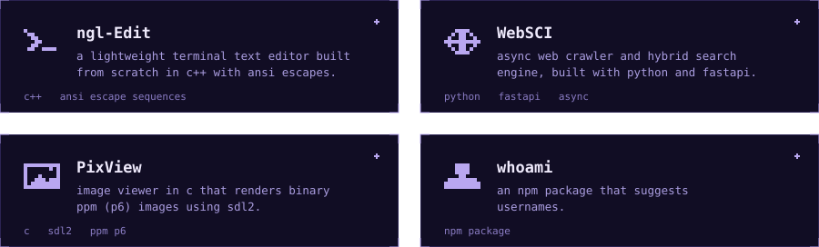
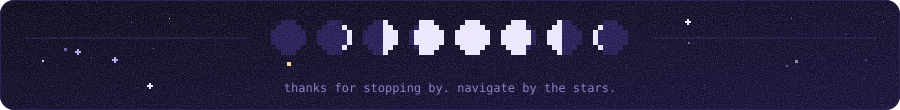

  

  

Second-year B.Tech Computer Science student at **IIEST Shibpur**. I like understanding how software works beneath the surface, and I learn by building: a terminal editor in C++, a search engine in Python, an image viewer in C.

I'm looking for **winter internships**, **research opportunities** and **open-source collaborations**. When I can, I solve algorithm problems on [Codeforces](https://codeforces.com/profile/stackrift._.15).

  

  

  <a href="https://github.com/st4ckrift/ngl-Edit">ngl-Edit</a> &nbsp;·&nbsp;
  <a href="https://github.com/st4ckrift/WebSCI">WebSCI</a> &nbsp;·&nbsp;
  <a href="https://github.com/st4ckrift/PixView">PixView</a> &nbsp;·&nbsp;
  <a href="https://github.com/st4ckrift/whoami">whoami</a>

  

  
  
  

  

